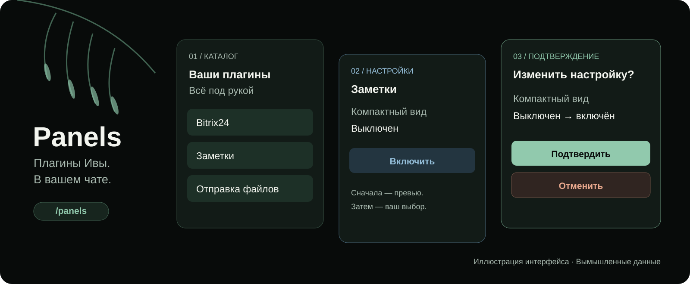

<div align="center">



# Panels для Ивы

**Настройки под рукой. Действия — после подтверждения.**

[](LICENSE)
[](CONTRIBUTING.md)

[Возможности](#что-умеет-panels) · [Начать](#начать) · [Авторам плагинов](#авторам-плагинов) · [Документация](#документация)

</div>

Panels добавляет к [Иве](https://github.com/smixs/iva-agent) общий интерфейс плагинов
в Telegram. Откройте `/panels`, выберите плагин и поменяйте настройку кнопками.
Если интеграция готовит действие в разговоре, она может показать карточку
подтверждения прямо в чате.

Название в списке сразу открывает доступные настройки или возможности.
**«О плагине»** рядом — версия, подключение и включение/выключение.
Можно перейти напрямую: `/panels bitrix24-read`. Команда `/ panels` тоже принимается.
Для поручения просто напишите Иве; поддерживаемое подтверждение придёт в чате.

Переходы обновляют одно сообщение. Перед изменением вы видите, что произойдёт,
и выбираете **«Подтвердить»** или **«Отменить»**. Права, проверку данных и выполнение
обеспечивает сам плагин.

> **Каналы:** стабильная **0.2.0** — каталог и общий API; кандидат **0.3.0-rc.5**
> добавляет прямой вход в настройки, карточки в чате, диагностику API и управление плагинами на Иве 0.5.7.
> Репозиторий пока приватный. Установка на чистую Иву остаётся отдельной проверкой.

## Что умеет Panels

| Задача                                | Как это выглядит                                                                                             |
| ------------------------------------- | ------------------------------------------------------------------------------------------------------------ |
| Найти установленный плагин            | `/panels` показывает каталог, версии, состояние включения и доверия.                                         |
| Открыть настройки                     | Плагин отдаёт актуальные значения и доступные кнопки через общий API.                                        |
| Изменить значение                     | Выбор → превью → подтверждение или отмена → результат.                                                       |
| Подтвердить действие в разговоре      | Поддерживающий интеграцию плагин присылает карточку в тот же личный чат. Доступно в 0.3 RC.                  |
| Подключить другой плагин              | **«Как добавить настройки»** объясняет, чего не хватает; Ива проверяет интеграцию поставляемым инструментом. |
| Посмотреть сведения о доставке файлов | Совместимая панель показывает правила известной версии и проверяет публичный stable.                         |

Базовая карточка появляется у каждого зарегистрированного плагина. Настройки и
действия доступны, когда автор плагина добавил поддержку API. Для нового плагина
не требуется выпускать новую версию Panels.

Включение и выключение — отдельная дополнительная функция с превью,
подтверждением и проверкой результата. Начиная с **0.3.0-rc.4** она поддерживает
точную Иву **0.5.7/ae313753a1ae**, а также прежние закреплённые 0.4.12/0.4.14.
Функцию разрешает оператор; неизвестная сборка отклоняется до команды.
[Матрица и границы проверок](docs/COMPATIBILITY.md).

## Начать

Нужны работающая Ива на Linux, Node.js 24, `bash` и `flock`.
Panels использует вашего Telegram-бота; отдельный бот и публичный домен не нужны.

1. Выберите [совместимую версию](docs/COMPATIBILITY.md) и источник плагина.
2. Установите службу через штатный менеджер Ивы и подготовьте приватный конфиг.
3. Проверьте обычный ответ Ивы, подключите маршрут и откройте `/panels`.

**[Пошаговая настройка и возврат прежнего маршрута →](docs/SETUP.md)**

Установка пока требует оператора: нужно явно настроить локальный маршрут Bridge.
Одного добавления плагина недостаточно. Для приватного репозитория доступ к исходникам
нужен и машине, которая получает плагин. Готовой публичной команды установки пока нет.

## Действие прямо в разговоре

Например, плагин Bitrix24 может подготовить приглашение сотруднику:

```text
Пригласи Анну Тестову в отдел дизайна. Почта: anna@example.test.
```

Ива уточнит недостающие данные. Когда предложение готово, Bitrix24 передаст его
Panels, и в чате появится карточка с условиями и кнопками. Отправка карточки
сама по себе не выполняет действие. После подтверждения плагин проверит права
и покажет результат.

Для этого примера нужны Bitrix24 **0.10.0-rc.4**, разрешённый в нём кадровый сценарий
и Panels **0.3 RC** с общим API. Возможности других интеграций определяют их авторы.
[Как устроены карточки](docs/CHAT_CARDS.md).

## Авторам плагинов

Есть три уровня подключения:

| Уровень              | Что добавить в свой плагин       | Что получает пользователь                                            |
| -------------------- | -------------------------------- | -------------------------------------------------------------------- |
| Справка              | Декларативный `panels.json` v1   | Информационные страницы и переходы.                                  |
| Настройки и действия | `panels.json` v2 и локальный API | Живые значения, превью, подтверждение, отмена и проверка результата. |
| Карточки в чате      | Вызов API карточек поверх v2     | Подтверждение прямо в разговоре с Ивой.                              |

Начните с **[руководства по интеграции](docs/INTEGRATION.md)**: там рабочий пример,
код, схемы и порядок проверок. [Пример настроек](examples/dynamic-notes/) запускается
отдельным процессом и не требует зависимостей npm. Для существующего плагина
подключайте его собственное хранилище и проверки прав.

Можно попросить Иву:

```text
Загрузи skill iva-panels-integration и подготовь подключение моего плагина
к Panels. Сохрани его обычную работу и используй существующие настройки.
```

Skill, контракт, схема и пример кода поставляются вместе с Panels. Ива может
доработать доступные исходники по запросу; кнопка подключения сама код не меняет.
Закрытый плагин без исходников или подходящего API потребует участия его автора.

## Что важно знать

- Panels предназначен для личных чатов разрешённых пользователей; карточки 0.3 RC требуют одного настроенного владельца.
- Старые кнопки истекают. Откройте новый `/panels`, если экран больше не отвечает.
- При неизвестном исходе операция не повторяется автоматически: используйте проверку результата.
- Panels — доверенный локальный компонент с доступом к токену бота. Секреты вводятся на сервере, не в переписке.
- Установка, обновление, удаление и выдача доверия другим плагинам остаются у штатного менеджера Ивы.

[Частые вопросы и решение проблем](docs/FAQ.md) · [Безопасность](SECURITY.md)

## Документация

| Пользователю и оператору                          | Автору плагина и участнику проекта                                |
| ------------------------------------------------- | ----------------------------------------------------------------- |
| [Установка и обновление](docs/SETUP.md)           | [Подключение плагина](docs/INTEGRATION.md)                        |
| [Возможности и ограничения](docs/CAPABILITIES.md) | [Динамический API v2](docs/DYNAMIC_API.md)                        |
| [Совместимость и проверки](docs/COMPATIBILITY.md) | [Информационные страницы v1](docs/PLUGIN_API.md)                  |
| [Вопросы и диагностика](docs/FAQ.md)              | [API карточек в чате](docs/CHAT_CARDS.md)                         |
| [Помощь](SUPPORT.md)                              | [Разработка и тесты](CONTRIBUTING.md)                             |
| [История изменений](CHANGELOG.md)                 | [Архитектура](docs/ARCHITECTURE.md), [выпуски](docs/RELEASING.md) |

Лицензия [MIT](LICENSE).
