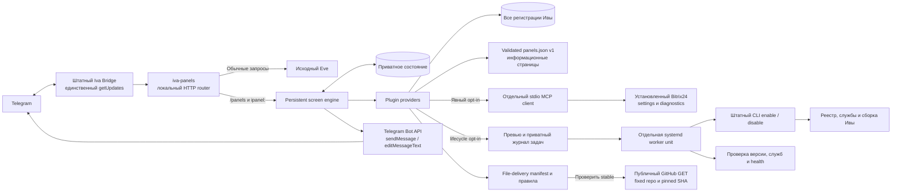

# Архитектура iva-panels

## Компоненты

Отдельный service plugin встраивается между Bridge и HTTP origin Eve через адрес назначения Bridge. Ядро и его MCP-сессии не изменяются. Второй читатель Telegram updates не создаётся. Такой маршрут зависит от внутренних контрактов Bridge и требует проверки при обновлении Ивы.

## От события до экрана

Первоначальная отправка сохраняет `sending` до Bot API. Неизвестный результат отправки переводится в `uncertain` без повторного `sendMessage`. После сбоя редактирования то же событие доставляет сохранённый вид; provider повторно не вызывается. Telegram «message is not modified» считается успешным редактированием.

Собственные события сериализованы в одном процессе. Linux launcher удерживает kernel lock на каталог данных, запрещая второй экземпляр. Состояние записывается через временный файл, fsync и rename с синхронизацией каталога. Это не распределённая транзакция с Telegram; абсолютная гарантия exactly-once отправки невозможна.

## Контракты и ограничения

- Собственные события: ровно `/panels` или префикс `ipanel:`. Прочие команды, native callbacks и HTTP маршруты передаются исходному Eve.
- В `POST /eve/v1/telegram/accepted` обработанное событие получает 204 и `x-iva-telegram-acceptance: handled`; в `POST /eve/v1/telegram` — 200. Ошибка своего обработчика возвращает 503, без передачи текста модели.
- Callback несёт случайный screen ID, ревизию и индекс кнопки. Действие берётся из сохранённого представления, а не из произвольной строки события.
- Экран живёт 15 минут; до 100 экранов и 500 квитанций. Вытеснение завершённых квитанций продвигает нижнюю границу update ID: более старые собственные события игнорируются. Предполагается последовательная эпоха Telegram update ID; восстановление бота и сброс счётчика требуют отдельного решения.
- Размер входящего события ограничен 1 MiB; карточка и кнопки ограничены схемой. Текст выводится буквально с HTML escaping.
- Каталог читает все регистрации, а базовые карточки — ограниченный manifest. Внешние descriptor v1 и встроенные адаптеры доступны только enabled + trusted. Явный opt-in добавляет read-only настройки и диагностику Bitrix24 через отдельную stdio-сессию. При повреждении или отсутствии реестра операция завершается ошибкой.

Незавершённые редактирования защищены от конкурентного действия, но постоянный отказ Telegram пока не имеет автоматического восстановления. Плагин не регистрирует `/panels` в видимом списке Telegram-команд. Общая очередь Bridge может задержать обработку кнопок во время работы агента.

## Дальнейшая область

Имя `iva-panels` допускает карточки, списки и мастера для независимых интеграций. Provider остаётся внутренним TypeScript интерфейсом. Публичный descriptor v1 описывает информационные страницы; общий динамический API действий ещё не реализован. Внешние данные и запись не добавляются через случайное подключение чужой MCP-сессии. Для них понадобятся явный контракт адаптера, границы прав и отдельные тесты. Если upstream предоставит подходящий официальный API экранов, транспорт можно заменить, сохранив представления и навигацию.

## Пачки сообщений Bridge

Durable inbox объединяет быстрые сообщения в `message.iva_parts`. Router проверяет все части: собственные обрабатываются по отдельности, обычные отправляются Eve с первоначальным maximum update ID и queue receipt. Смешанная пачка получает итоговую квитанцию от Eve после обработки собственных частей. При отказе downstream повтор не создаёт лишний экран: hash владельца/чата/message ID/текста переживает перегруппировку inbox. Для batch квитанций ключ включает update ID, индекс и hash; index может сдвинуться после частичного durable ack.

Чтение прежнего dev.1 state поддержано; dev.1 не понимает новые batch keys. После первого batch не откатывайте бинарник на dev.1 с тем же state. Существующий порог вытеснения update ID и ограниченная глубина квитанций сохраняются; это не вечная история идемпотентности.

## Изменение локальной политики Bitrix24

Явный opt-in добавляет prepare/confirm/cancel к существующему settings tool. Engine сохраняет acting до вызова provider, затем сохраняет view/revision/editing и доставляет его. Reply выводится из сохранённой кнопки; preview UUID не передаётся в callback_data. Повтор editing доставляет только view. Повтор acting читает текущие настройки через recover и не вызывает действие снова. Формат старых экранов читается, но старый бинарник не понимает acting phase. [ADR 0003](adr/0003-confirmed-bitrix-settings.md).

## Панель отправки файлов

`files.ts` читает ограниченный manifest и показывает правила известного выпуска. Подстраницы `files:rules/updates/check` разрешены только для включённого и доверенного file-delivery. Только check обращается к фиксированному GitHub без credentials: stable commit → manifest по SHA → последний push ci.yml по SHA. Он не вызывает штатный updater и не затрагивает update offer. Установка остаётся в обычном диалоге Ивы.

## Управление плагинами

Встроенный lifecycle provider работает независимо от descriptor. Engine сохраняет acting и ID действия до provider. Confirm сохраняет queued до systemd-run; worker сохраняет running до CLI. Поэтому сбой engine восстанавливает только чтение результата, а CLI переживает рестарт Eve/Router. Ни delivery retry, ни кнопка проверки результата не повторяют команду. Статусы и пределы описаны в [ADR0006](adr/0006-native-lifecycle.md). Shared screen state читает только Router; worker меняет отдельный job файл. Update/downgrade исключает pending задачи.
